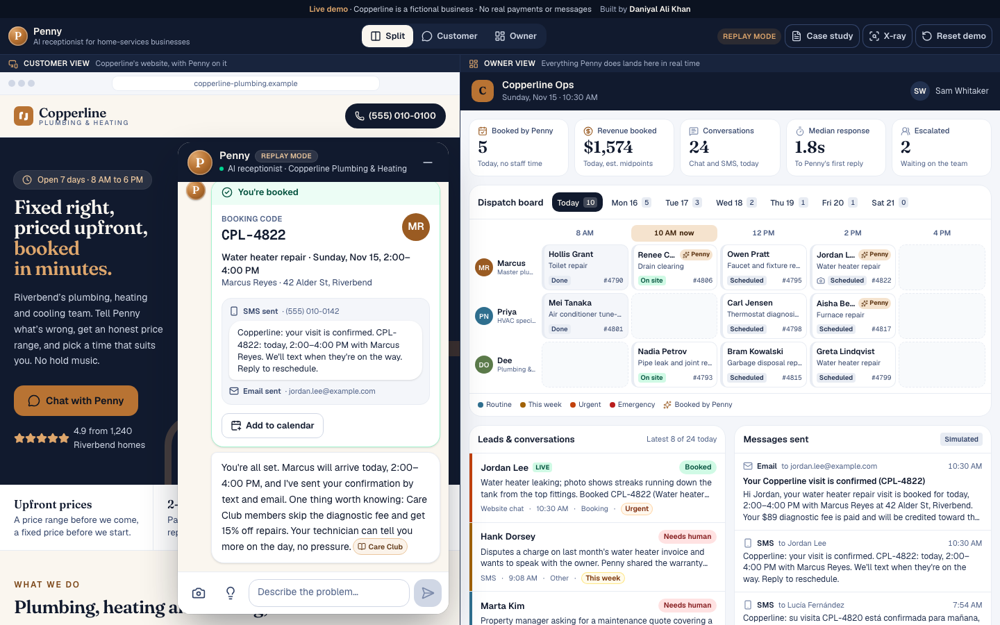
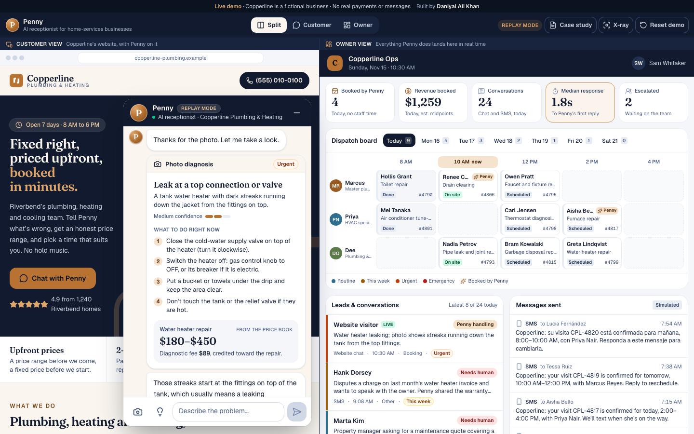
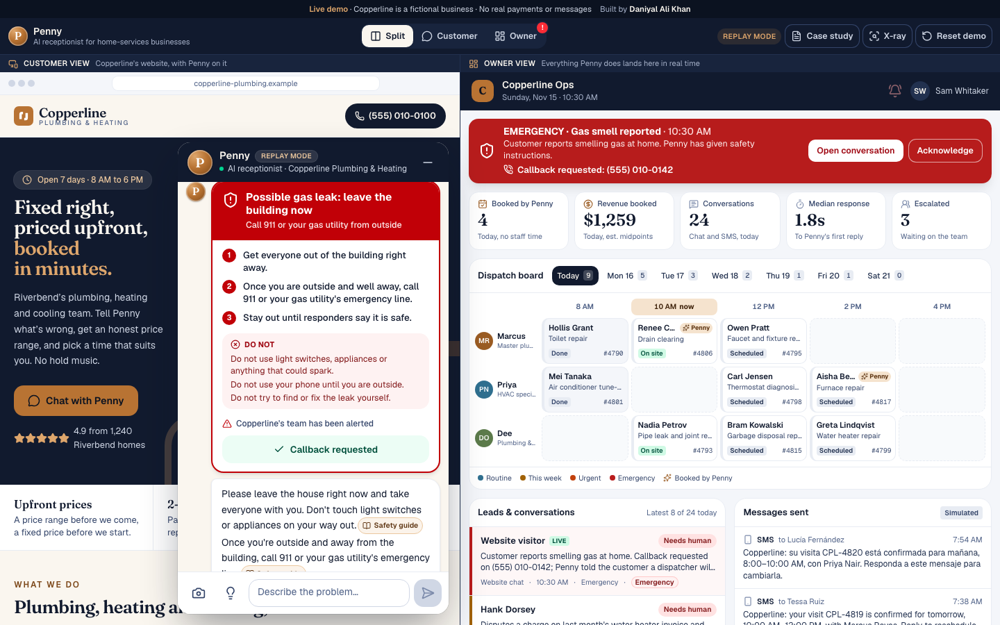
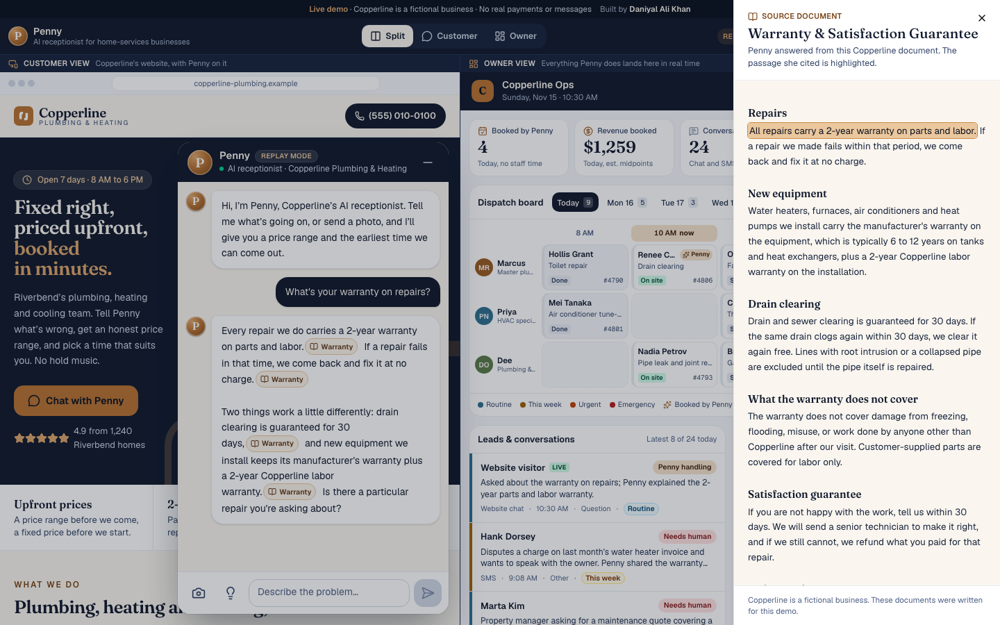
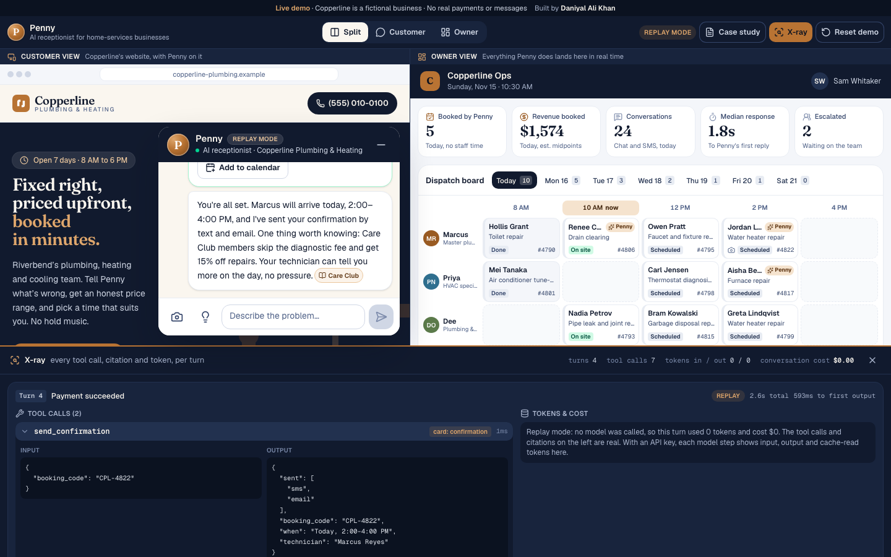

# Penny: an AI receptionist for a home-services business

Penny answers a plumbing and heating company's customers the moment they write in. She looks at their photo, quotes from the real price book, books a technician, takes the diagnostic fee and puts the job on the dispatch board, while the owner watches it happen.

**Live demo:** (link coming)



> **Copperline Plumbing & Heating is a fictional business.** The people, reviews, phone numbers, towns and ZIP codes are made up. No real payments, text messages or emails are sent. The checkout accepts only the `4242 4242 4242 4242` test card.

A 30-second walkthrough of the golden path is in [`docs/demo.webm`](docs/demo.webm).

## What it does

The demo is a split screen. On the left is Copperline's website with Penny's chat widget; on the right is the owner's operations dashboard. Everything Penny does on the left shows up on the right as it happens.

| | |
|---|---|
| **Photo diagnosis** | Send a photo and Penny returns a diagnosis card: what she sees, how urgent it is, safe things to do right now, and a price range from the price book. |
| **Booking, end to end** | Real availability as a tappable slot picker, a details form, a checkout for the diagnostic fee and a confirmation with booking code, calendar file and SMS preview. |
| **Grounded answers with citations** | Policy answers come from eight company documents. Each claim carries a chip that opens the source with the cited passage highlighted. |
| **Emergency triage** | Gas smell, carbon monoxide, sparking or flooding: safety instructions first, a red alert on the dashboard, and an immediate callback offer. |
| **Human takeover** | The owner clicks **Take over** on any conversation, replies from the dashboard, then hands back. Penny knows what was said. |
| **Live owner dashboard** | KPIs, a dispatch board by technician and time, a leads inbox with AI summaries (always in English), and a log of messages sent. |
| **Multilingual** | A customer who writes in Spanish gets Spanish back, including the cards. |
| **X-ray mode** | For technical buyers: every tool call with its input and output, the citations used, tokens, cache reads, latency and cost, per turn. |
| **Guardrails** | Penny says she is an AI when asked, stays on topic, and will not change prices, reveal her instructions or follow instructions written inside an image. |

<table>
<tr>
<td></td>
<td></td>
</tr>
<tr>
<td></td>
<td></td>
</tr>
</table>

More screenshots, including mobile, are in [`docs/screenshots`](docs/screenshots). There is also a client-facing write-up at [`/case-study`](src/app/case-study/page.tsx).

## Two engines, one interface

Penny runs in one of two modes, chosen automatically:

- **Live** when `ANTHROPIC_API_KEY` is set. Replies come from Claude through a streaming tool loop.
- **Replay** when there is no key (or `PENNY_MODE=replay`). Scripts decide what Penny says and which tools to call for the suggested prompts and common variations. Anything else gets a short "live AI is switched off" reply, and the UI shows a **Replay mode** pill.

Both engines emit the same event stream and call **the same server tool functions**. In replay mode the price book, availability, bookings, state patches, cards, dashboard, takeover and caps are all genuinely exercised; only the language model's choices are scripted. Replay also stays in the shipped product as a safety net: if the key is missing, invalid, or the daily live budget is used up, the demo falls back to replay instead of breaking.

> **Status of this repo:** built and verified in replay mode first, then verified against the real Claude API on 16 November 2026, on both Claude Opus 5.5 and Claude Haiku 5.5. [`docs/live-verification.md`](docs/live-verification.md) records what was checked, what had to change, and what it cost.

## Architecture

```
Browser                               Server (/api/chat)                    Sources of truth
┌───────────────────────────┐  turn   ┌──────────────────────────────┐      ┌───────────────────┐
│ Chat widget               │ ──────▶ │ zod validation, caps, limits │      │ Price book        │
│ Owner dashboard           │         │                              │      │ Calendar logic    │
│ Sandbox state (Zustand,   │ ◀────── │ Live engine  │ Replay engine │ ───▶ │ Company documents │
│ localStorage, per visitor)│ events  │       └── same tools ──┘     │      │ Claude API        │
└───────────────────────────┘         └──────────────────────────────┘      └───────────────────┘
```

- **No database.** Each visitor gets an isolated sandbox (technicians, a 7-day calendar relative to their today, jobs, leads, messages) that lives in their browser and is wiped by **Reset demo**.
- **The server holds the truth.** The system prompt, the documents and the price book never leave the server. The browser sends its sandbox with each turn; the server validates it with zod and re-checks every price and every slot against its own price book and availability logic before a tool acts on it.
- **Tools return state patches.** A tool result carries what the model sees, a card for the customer, and a list of patches (`job.add`, `lead.update`, `alert.raise`, …). The client applies them, so both panes update from one event.
- **The visitor pays, not the model.** `create_booking` only holds a slot. `/api/pay` confirms it, always for the price book's fee, and only then can `send_confirmation` succeed.

Key files:

| Path | What it is |
|---|---|
| `src/lib/server/tools.ts` | The thirteen tools, shared by both engines |
| `src/lib/server/engine/live.ts` | Streaming Claude tool loop |
| `src/lib/server/engine/replay.ts` | Scripted engine and intent router |
| `src/lib/server/engine/prompt.ts` | System prompt and deterministic history builder |
| `src/lib/server/pricebook.ts`, `docs.ts` | Price book and the eight documents |
| `src/lib/server/limits.ts` | Caps and rate limiting |
| `src/lib/domain/` | Types, scheduling, state patches, seed data, the stream reducer |
| `src/lib/client/store.ts` | The visitor's sandbox |
| `evals/` | Behavioural eval suite |

## How it works

**Tool loop.** The live engine uses the official `@anthropic-ai/sdk` and a manual streaming loop: stream a step, forward text deltas, run any tool calls, send all results back in one message, repeat (capped at six steps). Tools are declared with `strict: true` schemas and every input is validated again with zod before it runs. The model is `ANTHROPIC_MODEL` (default `claude-opus-5-5`; `claude-haiku-5-5` also works) at `ANTHROPIC_EFFORT` (default `low`).

**Citations.** The eight documents are sent as document blocks with citations enabled. Claude's cited spans come back as character ranges into the same plain text the drawer displays, so the highlight is exact. The pricing document is generated from the price book, so a cited price and a tool-returned price cannot disagree. Live testing showed the model occasionally gives a correct policy answer and leaves the citation off, so there is a safety net: when a question-and-answer reply arrives with no citations, the server matches each sentence against the documents itself (word matching plus a check that every figure in the sentence appears in the passage; no second model call) and links the passage, or links nothing if it is not confident. X-ray labels those links "matched by the server".

**Prompt caching.** Tools, system prompt and documents are identical for every visitor and every turn, so they sit behind one cache breakpoint and are shared across all conversations. The conversation tail uses automatic caching. History is rebuilt deterministically from the transcript, so each request extends the previous one's prefix. X-ray mode shows the cache-read tokens on every step.

**Refusals.** On models that support it the request opts into server-side refusal fallbacks. `stop_reason` is checked before content is used; a refusal that still comes back becomes a polite message, and a tool call cut off by `max_tokens` is never executed.

**Cost per conversation.** Measured against the live API on 16 November 2026. A full photo-to-paid-booking conversation (four customer turns, eight tool calls) cost **about 11 cents on Claude Opus 5.5** in the browser ($0.109 in X-ray; $0.114 for the same path in the eval suite) and **about half a cent on Claude Haiku 5.5** ($0.0055). The tools, instructions and documents come to about 14,000 tokens, and after the first request they are read from the cache on every step: 95% of the input tokens in that conversation were cache reads. The first conversation after the cache has gone cold pays a one-off write of about 7 cents on Opus. These figures are the token counts the API reported multiplied by the published prices in `src/lib/server/engine/cost.ts`, not an invoice; X-ray mode shows the same calculation for every turn.

**Cost safety.** Server-side caps on messages per conversation, characters per message, total transcript size, photos per conversation, upload size, `max_tokens` and tool steps; a per-IP rate limit; same-origin JSON only, so another site cannot spend the budget through its visitors; and a global daily budget in both turns and estimated dollars, after which Penny drops to replay. Each cap produces a friendly "demo limit reached" message. With Upstash Redis configured, the rate limit and budget are shared across server instances; without it they are per instance, so **set a hard spend limit on the API key as well**: that is the real ceiling.

## Quality

| Check | Result |
|---|---|
| `pnpm typecheck`, `pnpm lint`, `pnpm build` | Clean |
| `pnpm test` (Vitest) | 120 tests: scheduling, pricing, documents, tools, replay scenarios, live engine against a stubbed SDK client, the citation safety net, caps, rate limits, API routes, security regressions |
| `pnpm e2e` (Playwright) | 8 tests: golden path, emergency, citations, takeover, Spanish and reschedule, form recovery and pay-while-typing, mobile, reduced motion |
| `pnpm eval:replay` | 14 of 14 cases, 65 of 65 checks (2 cases need the live model and are skipped) |
| `pnpm eval` (live) | Claude Opus 5.5: 16 of 16 cases, 74 of 74 checks, $0.41 for the suite. Claude Haiku 5.5: 16 of 16 cases, 74 of 74 checks, $0.015 for the suite. Run on 16 November 2026; results are in `evals/results/`. Model output varies, so re-run after changing the prompt, tools or documents |
| `pnpm a11y` (axe-core, WCAG 2.1 A/AA) | No violations across 13 screens and states |
| Lighthouse (production build, local) | 100 performance, 100 accessibility, 100 best practices, 100 SEO, on both desktop and mobile presets |
| Reviews before shipping | Code review, independent security review ([findings and fixes](docs/security-review.md)), [accessibility audit](docs/accessibility-audit.md), and a fresh-eyes "try to break it" pass as a first-time client |

The eval suite scripts 16 conversations and asserts on which tools were called with which arguments and on the resulting state, not on wording: golden path, gas emergency, out-of-area ZIP, non-repair photo, Spanish, reschedule, warranty citation, price accuracy, prompt injection in text and inside an image, "are you human?", off-topic, an over-long message, rapid-fire spam, cancellation needing confirmation, and takeover hand-back.

## Run it locally

Requires Node 20+ and pnpm.

```bash
pnpm install
cp .env.example .env.local   # optional: with no key, Penny runs in replay mode
pnpm dev
```

Open http://localhost:3000. Adding `ANTHROPIC_API_KEY` to `.env.local` and restarting switches to live mode with no other change.

```bash
pnpm test          # unit tests
pnpm e2e           # builds, then runs the Playwright tests in replay mode
pnpm eval:replay   # eval suite through the replay engine (free)
pnpm eval          # eval suite against the real API (needs a key, costs cents)
pnpm a11y          # axe-core scan (needs the app running)
pnpm screenshots   # regenerates docs/screenshots and docs/demo.webm (needs the app running)
```

## Environment variables

All are documented in [`.env.example`](.env.example).

| Variable | Default | Purpose |
|---|---|---|
| `ANTHROPIC_API_KEY` | blank | Blank means replay mode. Use a dedicated key with a spend limit. |
| `ANTHROPIC_WORKSPACE_ID` | blank | Only for a key that is not scoped to one workspace: the workspace to bill. |
| `ANTHROPIC_MODEL` | `claude-opus-5-5` | Model for live mode. |
| `ANTHROPIC_EFFORT` | `low` | Reasoning effort. Keep it constant; changing it invalidates the cache. |
| `PENNY_MODE` | blank | Set to `replay` to force the scripted engine. |
| `NEXT_PUBLIC_AUTHOR_NAME`, `NEXT_PUBLIC_HIRE_URL` | blank | "Built by … · Hire me" in the banner. The link is hidden if the URL is blank. |
| `PENNY_MAX_TURNS`, `PENNY_MAX_MESSAGE_CHARS`, `PENNY_MAX_IMAGES`, `PENNY_MAX_UPLOADS`, `PENNY_MAX_TOKENS`, `PENNY_MAX_TRANSCRIPT_CHARS` | 30, 1500, 6, 3, 4096, 60000 | Per-conversation caps. |
| `PENNY_RATE_PER_MINUTE`, `PENNY_RATE_PER_DAY` | 20, 200 | Per-IP rate limits. |
| `PENNY_DAILY_LIVE_TURNS`, `PENNY_DAILY_BUDGET_USD` | 1500, 5 | Global daily live budget (turns and estimated dollars) before falling back to replay. |
| `UPSTASH_REDIS_REST_URL`, `UPSTASH_REDIS_REST_TOKEN` | blank | Optional. Makes the rate limit and daily budget shared across serverless instances. Recommended for a public live link. |
| `PENNY_CLIENT_IP_HEADER` | blank | Only off Vercel: the header your proxy sets to the visitor's address. |

## Deploy to Vercel

[](https://vercel.com/new/clone?repository-url=https%3A%2F%2Fgithub.com%2Fdaniyalalikhan710-lgtm%2Fpenny-ai-receptionist&env=NEXT_PUBLIC_AUTHOR_NAME&envDescription=Optional%3A%20add%20ANTHROPIC_API_KEY%20for%20live%20mode.%20Without%20it%20Penny%20runs%20in%20replay%20mode.&envLink=https%3A%2F%2Fgithub.com%2Fdaniyalalikhan710-lgtm%2Fpenny-ai-receptionist%2Fblob%2Fmain%2F.env.example)

No database or other services are needed. To go live after deploying, add `ANTHROPIC_API_KEY` (and optionally `ANTHROPIC_MODEL`) under Project → Settings → Environment Variables and redeploy. For a public link, also add the Upstash variables so the rate limit is shared across instances.

## What would change for a real business

The demo keeps each visitor's sandbox in their own browser, which is what makes it free to host and safe to share. A production build for a real company would replace that with real systems, and three things in particular would change:

- **State moves to the server.** Bookings, the calendar and the conversation history live in a database, so the server no longer accepts history from the browser. (Here, the server validates what the browser sends and the tools re-check every price, slot and payment, so a tampered client can only mislead its own chat, never get a wrong price on a card or a confirmation without payment.)
- **Staff sign in.** Taking over a chat would require an authenticated staff session. In the demo the "owner" is the same visitor, so staff notes are treated as conversation context that cannot change prices or rules.
- **Bookings are tied to the customer.** A booking code alone can look up, move or cancel a visit here, as a confirmation link would; it never reveals a surname or address. A real system would verify the phone number or send a one-time code first.

The audit behind these notes is in [`docs/security-review.md`](docs/security-review.md).

## Roadmap

Not built yet:

- A guided four-step tour for first-time visitors.
- Two-tab sync, so the owner view can sit in a second window.
- Voice input through the Web Speech API.
- Real integrations in place of the simulated ones: Stripe for the diagnostic fee, Twilio for texts, a calendar or field-service system for the board.

## Credits and license

Sample photos are from Unsplash; see [`CREDITS.md`](CREDITS.md). Design decisions made while building are logged in [`docs/decisions.md`](docs/decisions.md).

MIT. See [`LICENSE`](LICENSE).
